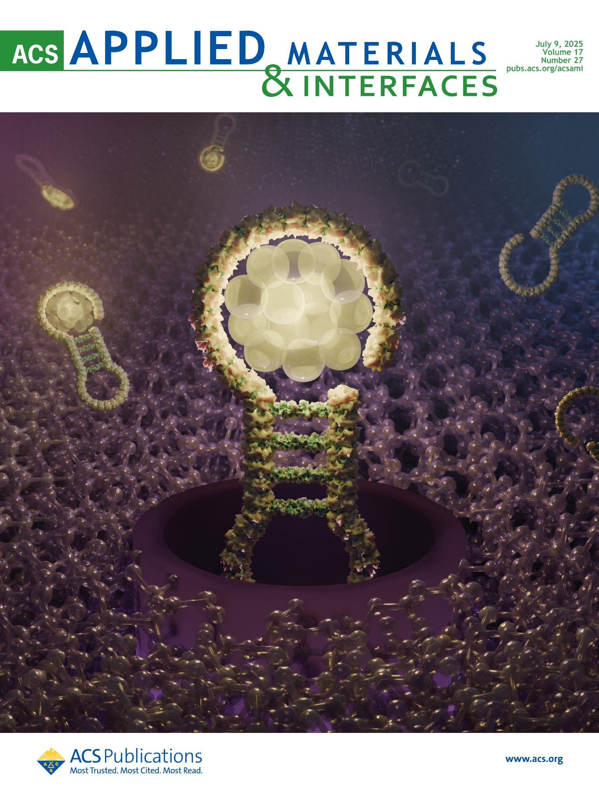
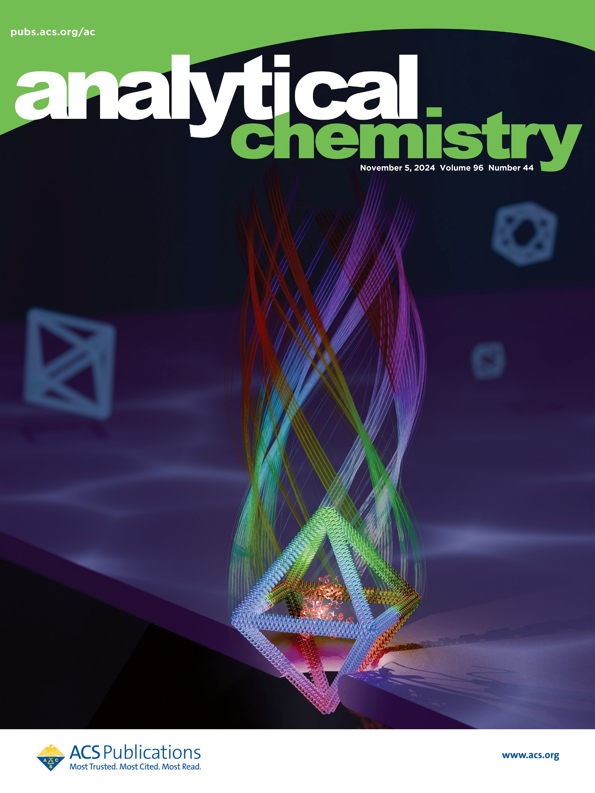

<figure class="cover-item">

<figcaption>ACS APPLIED MATERIALS &amp; INTERFACES<h2>DNA-hosted silver nanoclusters</h2>
Supplementary cover · July 9, 2025 Volume 17, Issue 27
<a href="https://doi.org/10.1021/acsami.5c02405">Read the article →</a>
Cover image: ACS Publications.
</figcaption>
</figure>
<figure class="cover-item">

<figcaption>ANALYTICAL CHEMISTRY<h2>DNA origami hybrid nanopores</h2>
Supplementary cover · November 5, 2024 Volume 96, Issue 44
<a href="https://doi.org/10.1021/acs.analchem.4c02016">Read the article →</a>
Cover image: ACS Publications.
</figcaption>
</figure>

[All publications](publications.qmd){.btn .btn-outline-primary}
