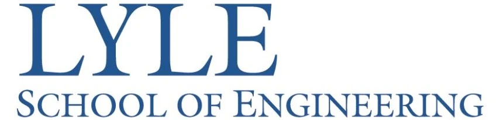
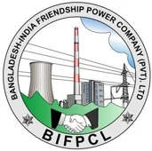
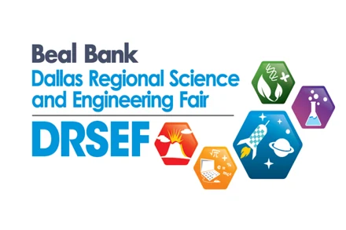
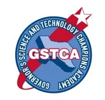
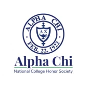
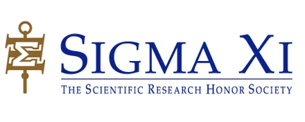
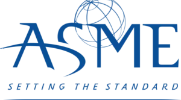

## Research experience

:::: {.organization-layout}

::: {.organization-copy}
**Research Assistant · BAST Laboratory, Southern Methodist University · January 2023–Present**

I conduct research in nanoscale fabrication, materials integration, device characterization, and single-molecule transport. My responsibilities include electrical measurements, experimental data analysis, manuscript contributions, and support for undergraduate and graduate laboratory activities. [Explore my research](research.qmd).
:::

<aside class="organization-logos" aria-label="Organization logos">

</aside>

::::

## Research techniques and skills

| Area | Techniques and tools |
|:--|:--|
| Nanofabrication | Nanoscale device fabrication and materials integration |
| Characterization | Ionic-current and current–voltage measurements, SEM/EDX, AFM, Raman, UV–Vis, and fluorescence spectroscopy |
| Instrumentation and prototyping | Axopatch/Digidata, Sutter P-2000, microfluidic flow-cell design, CAD, 3D printing, and Arduino-based instrumentation |
| Signal processing and statistics | Single-molecule event detection, current blockade and dwell-time analysis, power spectral density, signal-to-noise ratios, ANOVA, and effect sizes |
| Computation and machine learning | Python, MATLAB, and COMSOL Multiphysics; Gaussian mixture models, ensemble classification, and model interpretation with SHAP |
| Semiconductor processing coursework | Photolithography, oxidation, doping, etching, and metallization |

## Teaching and laboratory instruction

**Graduate Teaching Assistant · SMU Department of Mechanical Engineering · 2024–2025**

| Course | Role |
|:--|:--|
| ME 2342: Fluid Mechanics | Laboratory instructor, Fall 2024 and Spring 2025 |
| ME 2131: Thermodynamics | Laboratory instructor, Fall 2024 and Spring 2025 |
| ME 3132: Heat Transfer | Laboratory instructor, Fall 2024 and Spring 2025 |

I taught six laboratory course offerings across fluid mechanics, thermodynamics, and heat transfer, with about 20 students per class. I supervised and mentored student groups through experimental planning, apparatus operation, data collection, quantitative analysis, and technical reporting. Responsibilities included explaining theoretical and experimental principles, evaluating laboratory reports, providing feedback, and supporting students through demonstrations and individual assistance.

## Student research mentoring

**Instructor and Research Mentor · Governor’s Science and Technology Champions’ Academy (GSTCA) · SMU · 2025**

I mentored high-school students in hands-on nanopore experiments, laboratory procedures, experimental data analysis, and technical presentation.

### Undergraduate research mentoring

I trained undergraduate researchers in nanopore fabrication, device characterization, data acquisition, event extraction, and analysis. Projects included transferrin translocation (2023), dendrimer characterization (2025), and ferritin and transferrin sensing (2026).

### Teaching interests

My teaching interests include mechanical design, manufacturing processes and systems, CAD, introductory engineering design, senior design and capstone projects, engineering materials, and nanomanufacturing. I am also interested in thermodynamics, fluid mechanics, heat transfer, engineering experimentation and data analysis, as well as graduate topics in advanced manufacturing, nanoscale fabrication, semiconductor processing fundamentals, materials characterization, multiphysics modeling, and machine learning for engineering.

## Industry experience

### SA Classic Properties Sdn. Bhd. · Kuala Lumpur, Malaysia

**Advising Officer · March–December 2022**

Supported technical and operational management and coordinated technical and management functions.

### Bangladesh-India Friendship Power Company Ltd. · Bangladesh

:::: {.organization-layout}

::: {.organization-copy}
**Industrial Trainee · Maitree Super Thermal Power Plant · June–September 2021**

Supported mechanical engineering and project-management activities during construction of a **2 × 660 MW** thermal power plant. I assisted with supervision and coordination of mechanical equipment erection in collaboration with the mechanical engineering department, gaining practical experience in large-scale industrial project execution.
:::

<aside class="organization-logos" aria-label="Organization logos">

</aside>

::::

## Professional service

Peer reviewer for *ACS Omega* (American Chemical Society), 2026.

## University leadership and academic service

:::: {.organization-layout}

::: {.organization-copy}
As a Lyle Senator in the 112th SMU Student Senate, I authored a resolution supporting a university-wide en-route master’s pathway for Ph.D. students. The Senate passed the resolution. I received the Student Senate Senior Award in 2026.

| Period | Role |
|:--|:--|
| 2025–2026 | Lyle Senator, SMU Student Senate; represented engineering students in university governance |
| 2019–2022 | University Liaison Officer, Institution of Mechanical Engineers |
| 2019–2021 | Ambassador, International Global Network |
| 2019–2020 | Liaison Officer, Asia World Model United Nations II |
| 2019–2020 | Treasurer, Institution of Engineers Malaysia, SEGi Student Chapter |
| 2018 | Director of Logistics, Hult Prize, SEGi University |
:::

<aside class="organization-logos" aria-label="Organization logos">

</aside>

::::

## Community service

:::: {.organization-layout}

::: {.organization-copy}
**Category Judge · Dallas Regional Science and Engineering Fair · 2025**\
Evaluated student projects in biomedical science, engineering technology, and materials science.

[Governor’s Science and Technology Champions’ Academy mentoring](#student-research-mentoring)

**Organizing Volunteer · International Conference on Industry 4.0 · SEGi University, Malaysia · 2019**

**American Red Cross · Transport Specialist · North Texas Region · 2023–2024**\
Transported blood and blood products among Red Cross laboratories, hospitals, and collection sites.

**FIFA World Cup 2026 · Access Management Volunteer · Dallas, Texas · 2026**\
Supported International Broadcast Center access operations, including accreditation checks and resolution of access-related issues.
:::

<aside class="organization-logos" aria-label="Organization logos">

</aside>

::::

## Professional associations

:::: {.organization-layout}

::: {.organization-copy}
- Student Member, American Society of Mechanical Engineers (ASME), 2023–present.
- Associate Member, Sigma Xi, The Scientific Research Honor Society, 2026–present.
- Graduate Student Member, Alpha Chi National College Honor Society, 2026–present.
- Former Affiliate Member, Institution of Mechanical Engineers (IMechE), 2018–2023.
:::

<aside class="organization-logos" aria-label="Organization logos">

</aside>

::::

[Education](professional-profile.qmd#education) · [Honors and awards](honors-and-awards.qmd) · [Research presentations](conferences.qmd)
