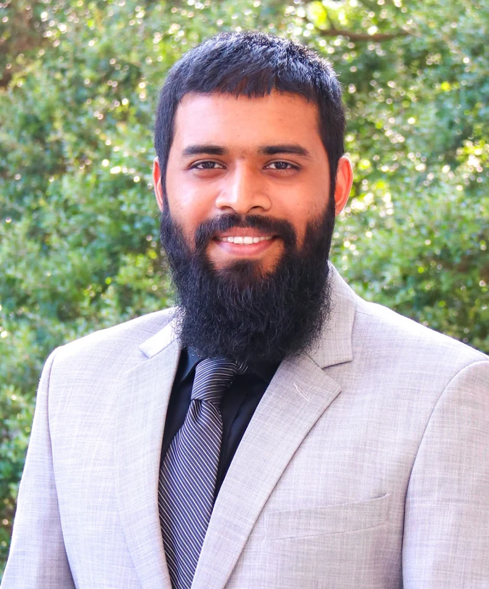
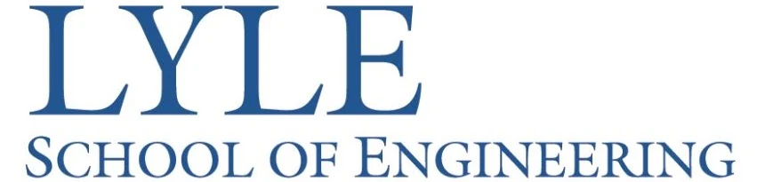

::: {.hero}
::: {.hero-copy}

Researcher · Engineer · Ph.D. Candidate

# Kamruzzaman Joty

**Nanoscale devices. Molecular measurements. Engineering methods.**

I am a Mechanical Engineering Ph.D. candidate at Southern Methodist University. I conduct research in the [BAST Laboratory](https://bastlabs.org/). My work connects nanoscale manufacturing, heterogeneous materials integration, experimental measurement, and data analysis to study molecular transport and develop single-molecule sensing platforms.

<a href="research.html">Explore research →</a><a class="secondary" href="assets/Kamruzzaman-Joty-Industry-Resume.pdf">Industry résumé</a><a class="secondary" href="mailto:kjoty@smu.edu?subject=Academic%20CV%20request">Request academic CV</a>

:::

:::

::: {.container-lg}

RESEARCH / ENGINEERING

## Selected research

Current research
<h3>Hybrid nanopore sensing</h3>
Ongoing research on hybrid nanopores for single-molecule sensing.
<a href="research.html#hybrid-nanopore-sensing">Explore research →</a>

Current research
<h3>Programmable nanopore fabrication</h3>
A published project on low-cost research instrumentation.
<a href="https://doi.org/10.1109/ACCESS.2026.3727354">Read the paper →</a>

Current research
<h3>Modeling and machine learning</h3>
Multiphysics simulations and event-level analysis for understanding and classifying nanopore measurements.
<a href="projects/modeling-ml.html">Explore project →</a>

Published research
<h3>Multilayer heterostructure nanopores</h3>
Investigating how layered two-dimensional materials and pore geometry affect directional molecular transport.
<a href="projects/heterostructures.html">Explore project →</a>

Published research
<h3>DNA-hosted silver nanoclusters</h3>
Studying voltage-dependent transport and electrolyte stability through solid-state nanopore measurements.
<a href="projects/silver-nanoclusters.html">Explore project →</a>

Published research
<h3>DNA origami hybrid nanopores</h3>
Incorporating three-dimensional DNA origami into solid-state nanopores to improve protein translocation measurements.
<a href="projects/dna-origami.html">Explore project →</a>

## Selected highlights

::: {.highlight-grid}

::: {.highlight-card}
[Three Minute Thesis](talks-news.qmd#three-minute-thesis)\
People’s Choice Award, SMU, 2025.
:::

::: {.highlight-card}
[Journal covers](journal-covers.qmd)\
Cover artwork for two published nanopore studies.
:::

::: {.highlight-card}
[Research coverage](talks-news.qmd#research-in-the-news)\
Read the SMU Lyle, Phys.org, and Newswise features.
:::

:::

## About my work

My research spans membrane fabrication, heterogeneous interfaces, ionic-current measurements, and computational interpretation of single-molecule events. I am also interested in applying my experience in cleanroom processing, instrumentation, and data-driven characterization to semiconductor and nanomanufacturing engineering.

[Watch my Three Minute Thesis presentation](talks-news.html){.btn .btn-outline-primary}

[Read my research overview](research.html) · [See publications](publications.html) · [Teaching & service](experience.html) · [Education & awards](professional-profile.html) · [Contact me](contact.html)

:::
