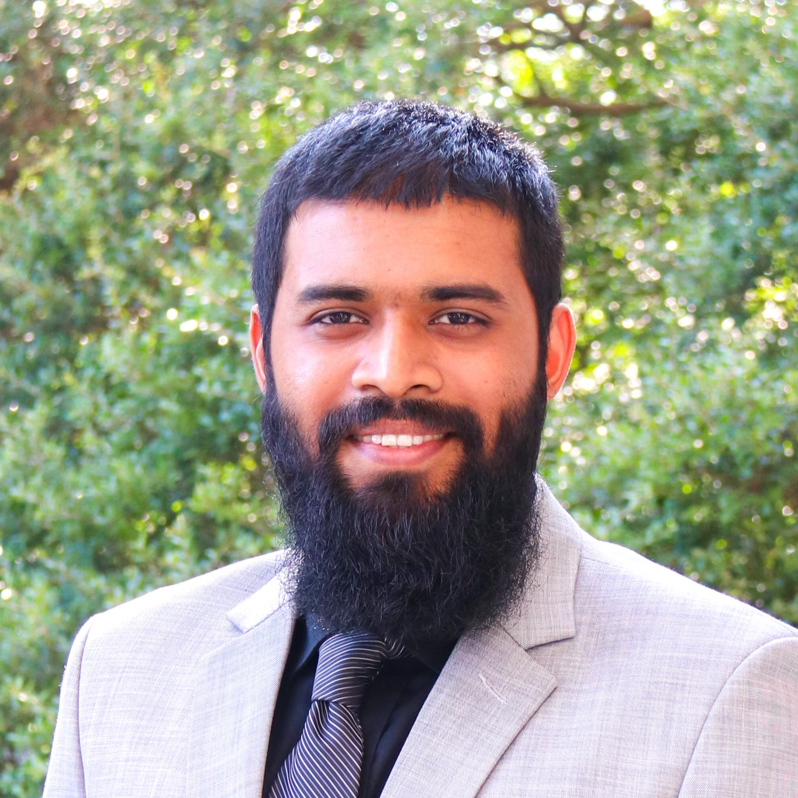

::: {.hero}
::: {.hero-copy}

Researcher · Engineer · Ph.D. Candidate

# Kamruzzaman Joty

**Nanoscale devices. Molecular measurements. Engineering methods.**

I am a Mechanical Engineering Ph.D. candidate at Southern Methodist University. I conduct research in the [BAST Laboratory](https://bastlabs.org/). My work connects nanoscale device fabrication, experimental measurement, and data analysis to study molecular transport and develop single-molecule sensing platforms.

<a href="research.html">Explore research →</a><a class="secondary" href="assets/Kamruzzaman-Joty-Resume.pdf">Download resume</a>

:::

:::

::: {.container-lg}

RESEARCH / ENGINEERING

## Selected research

Published research
<h3>DNA origami hybrid nanopores</h3>
Incorporating three-dimensional DNA origami into solid-state nanopores to improve protein translocation measurements.
<a href="projects/dna-origami.html">Explore project →</a>

Research project
<h3>Multilayer heterostructure nanopores</h3>
Investigating how layered two-dimensional materials and pore geometry affect directional molecular transport.
<a href="projects/heterostructures.html">Explore project →</a>

Instrumentation
<h3>Programmable nanopore fabrication</h3>
Experimental automation and controlled dielectric breakdown for nanoscale device fabrication.
<a href="projects/instrumentation.html">Explore project →</a>

Computational research
<h3>Modeling and machine learning</h3>
Multiphysics simulations and event-level analysis for understanding and classifying nanopore measurements.
<a href="projects/modeling-ml.html">Explore project →</a>

## About my work

My research spans membrane fabrication, heterogeneous interfaces, ionic-current measurements, and computational interpretation of single-molecule events. I am also interested in applying my experience in cleanroom processing, instrumentation, and data-driven characterization to semiconductor and nanomanufacturing engineering.

[Watch my Three Minute Thesis presentation](talks-news.html){.btn .btn-outline-primary}

[Read my research overview](research.html) · [See publications](publications.html) · [Contact me](contact.html)

:::
