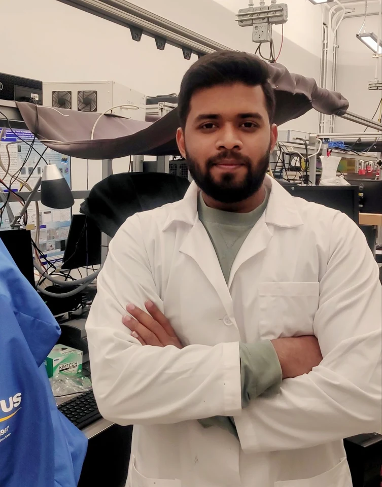
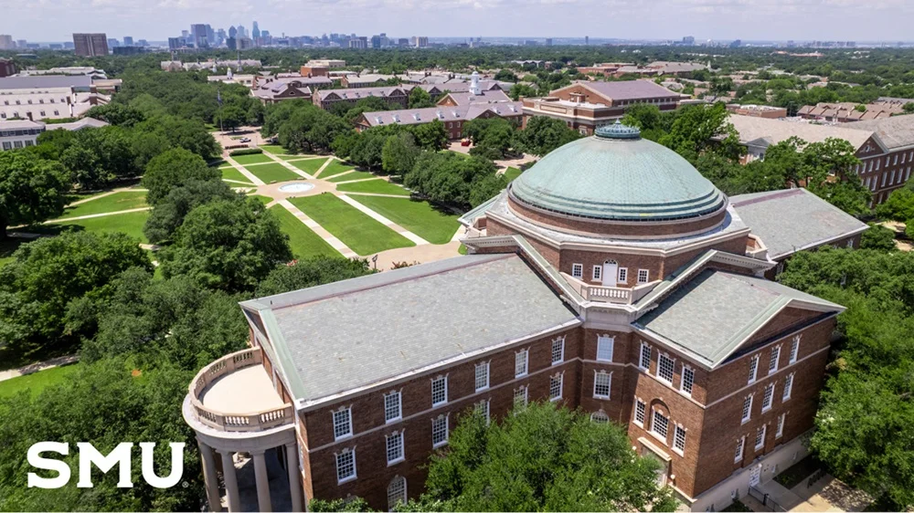
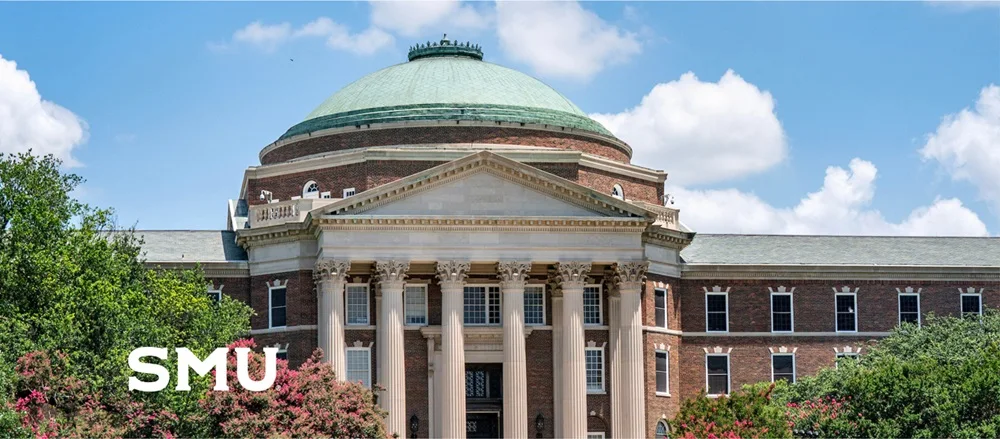
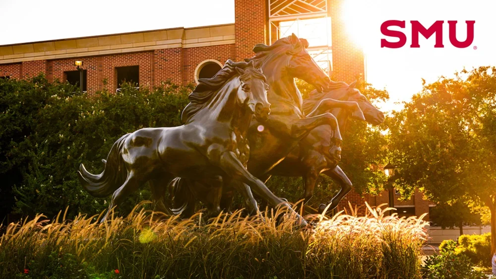
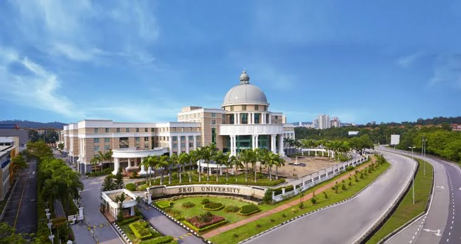
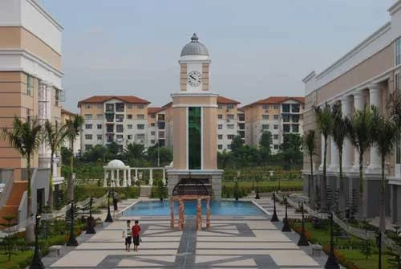

[Request academic CV](mailto:kjoty@smu.edu?subject=Academic%20CV%20request){.btn .btn-primary} [Industry résumé (PDF)](assets/Kamruzzaman-Joty-Industry-Resume.pdf){.btn .btn-outline-primary}

::: {.profile-intro}
{.profile-photo}

I’m a Mechanical Engineering Ph.D. candidate at Southern Methodist University and a graduate researcher in the BAST Laboratory. My work focuses on nanopore fabrication and single-molecule sensing.

[Research](research.qmd) · [Teaching and service](experience.qmd) · [Honors and awards](honors-and-awards.qmd)
:::

## Education

:::: {.campus-layout}

<!-- smu-gallery-start -->

<figure></figure>
<figure></figure>
<figure></figure>
<figure></figure>

<button type="button" class="btn btn-outline-primary" data-previous>Previous</button>

<button type="button" class="btn btn-outline-primary" data-next>Next</button>

<!-- smu-gallery-end -->

::: {.campus-copy}
### Southern Methodist University · Dallas, Texas

**Ph.D. in Mechanical Engineering · Expected May 2027**\
Dissertation: *Hybrid Nanopores for Next-Generation Single-Molecule Sensing*\
Advisor: Professor Min Jun Kim
:::

::::

:::: {.campus-layout}

<!-- segi-gallery-start -->

<figure></figure>
<figure></figure>
<figure></figure>
<figure></figure>

<button type="button" class="btn btn-outline-primary" data-previous>Previous</button>

<button type="button" class="btn btn-outline-primary" data-next>Next</button>

<!-- segi-gallery-end -->

::: {.campus-copy}
### SEGi University · Selangor, Malaysia

**Bachelor of Engineering (Honours) in Mechanical Engineering · February 2022**\
Undergraduate thesis: *Numerical Investigation of Onera M6 Forward and Backward Swept C-Wing Configuration at Supersonic Speed*\
Advisor: Engr. Vincent Tai
:::

::::

### Earlier education

- **Higher Secondary Certificate, Science** · Hazi Muhammad Muhsin College, Khulna, Bangladesh
- **Secondary School Certificate, Science** · Khulna Bidyut Kendra Secondary School, Khulna, Bangladesh

[Engineering portfolio](engineering-portfolio.qmd){.btn .btn-primary} [Teaching, experience & service](experience.qmd){.btn .btn-outline-primary}

