[Request academic CV](mailto:kjoty@smu.edu?subject=Academic%20CV%20request){.btn .btn-primary} [Industry résumé (PDF)](assets/Kamruzzaman-Joty-Industry-Resume.pdf){.btn .btn-outline-primary}

::: {.profile-intro}
{.profile-photo}

I’m a Mechanical Engineering Ph.D. candidate at Southern Methodist University and a graduate researcher in the BAST Laboratory. My work focuses on nanopore fabrication and single-molecule sensing.

[Research](research.qmd) · [Teaching and service](experience.qmd) · [Honors and awards](#honors-and-awards)
:::

## Education

### Southern Methodist University · Dallas, Texas

**Ph.D. in Mechanical Engineering · Expected May 2027**\
Dissertation: *Hybrid Nanopores for Next-Generation Single-Molecule Sensing*\
Advisor: Professor Min Jun Kim

<!-- smu-gallery-start -->

<figure></figure>
<figure></figure>
<figure></figure>
<figure>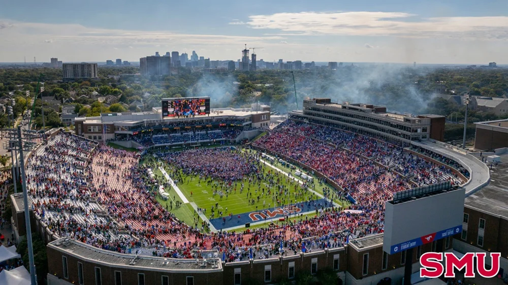</figure>

<button type="button" class="btn btn-outline-primary" data-previous>Previous</button>

<button type="button" class="btn btn-outline-primary" data-next>Next</button>

<!-- smu-gallery-end -->

### SEGi University · Selangor, Malaysia

**Bachelor of Engineering (Honours) in Mechanical Engineering · February 2022**\
Undergraduate thesis: *Numerical Investigation of Onera M6 Forward and Backward Swept C-Wing Configuration at Supersonic Speed*\
Advisor: Engr. Vincent Tai

<!-- segi-gallery-start -->

<figure></figure>
<figure>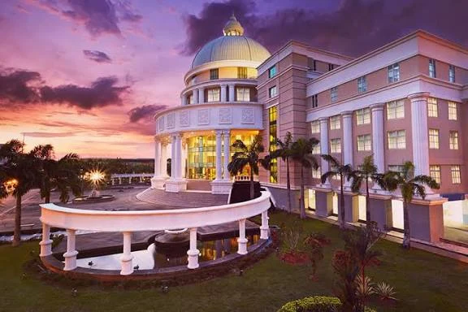</figure>
<figure></figure>
<figure></figure>

<button type="button" class="btn btn-outline-primary" data-previous>Previous</button>

<button type="button" class="btn btn-outline-primary" data-next>Next</button>

<!-- segi-gallery-end -->

### Earlier education

- **Higher Secondary Certificate, Science** · Hazi Muhammad Muhsin College, Khulna, Bangladesh
- **Secondary School Certificate, Science** · Khulna Bidyut Kendra Secondary School, Khulna, Bangladesh

## Research appointment

**Graduate Research Assistant · January 2023–Present**\
Department of Mechanical Engineering, Southern Methodist University\
[BAST Laboratory](https://bastlabs.org/) · Advisor: Professor Min Jun Kim

My work combines nanoscale fabrication, heterogeneous materials integration, experimental process development, electrical and materials characterization, and single-molecule transport. I contribute to experimental analysis and manuscripts and support undergraduate and graduate laboratory activities.

## Selected contributions

My published work includes eight journal articles, four as first or equal-contributing first author, and three peer-reviewed conference papers. [View publications](publications.qmd).

## Research interests

Advanced manufacturing and nanomanufacturing; nanoscale process development; solid-state and hybrid devices; heterogeneous integration; semiconductor and two-dimensional materials; experimental instrumentation and metrology; multiphysics transport; data-driven manufacturing and machine learning; single-molecule sensing.

## Honors and awards

| Year | Recognition |
|:--|:--|
| 2026 | Senior Award, SMU Student Senate |
| 2026 | Second Place, Outstanding Research & Presentation Award, SMU Industry Innovation Summit |
| 2025 | Shared People’s Choice Award, SMU Three Minute Thesis Competition |
| 2025 | Engineering is Art Award, SMU Lyle School of Engineering |
| 2024 | Best Presentation Award, SMU Research & Innovation Week Poster Competition |
| 2022 | Institution of Mechanical Engineers (IMechE) Project Award |
| 2020 | Frederic Barnes Waldron Best Student Award |
| 2017–2022 | Seven Dean’s List Awards |
| 2018–2019 | Three High Achievers Awards |
| 2017–2020 | Merit Scholarship |
| 2018 | IMechE Conference Grant |

## Professional associations

- Student Member, American Society of Mechanical Engineers (ASME), 2023–present.
- Associate Member, Sigma Xi, The Scientific Research Honor Society, 2026–present.
- Graduate Student Member, Alpha Chi National College Honor Society, 2026–present.
- Former Affiliate Member, Institution of Mechanical Engineers (IMechE), 2018–2023.

[Engineering portfolio](engineering-portfolio.qmd){.btn .btn-primary} [Teaching, experience & service](experience.qmd){.btn .btn-outline-primary}

<!-- award-gallery-start -->
## Award and certificate photos

<figure>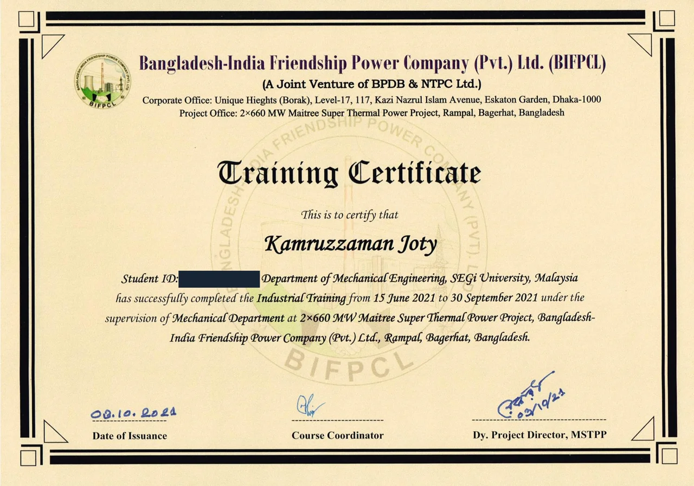</figure>
<figure>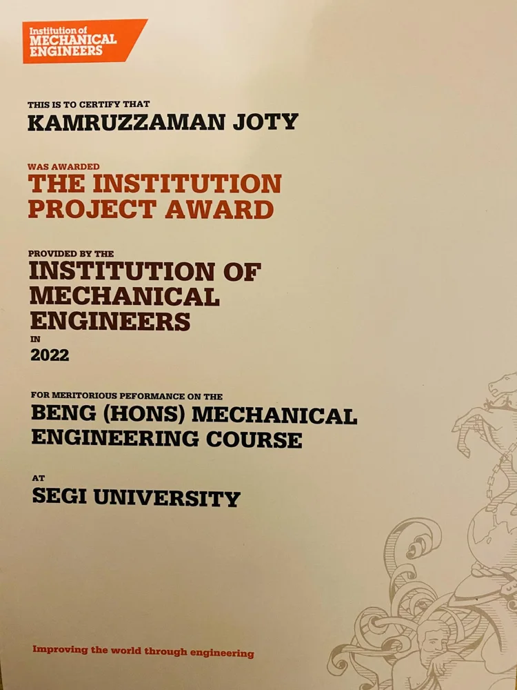</figure>
<figure>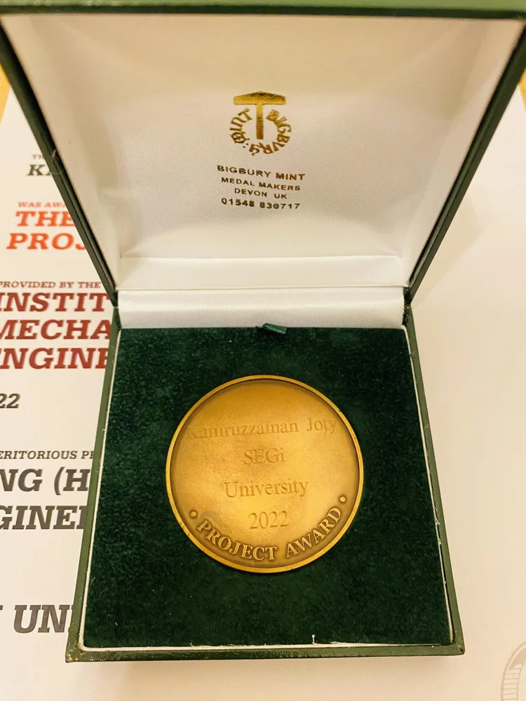</figure>
<figure>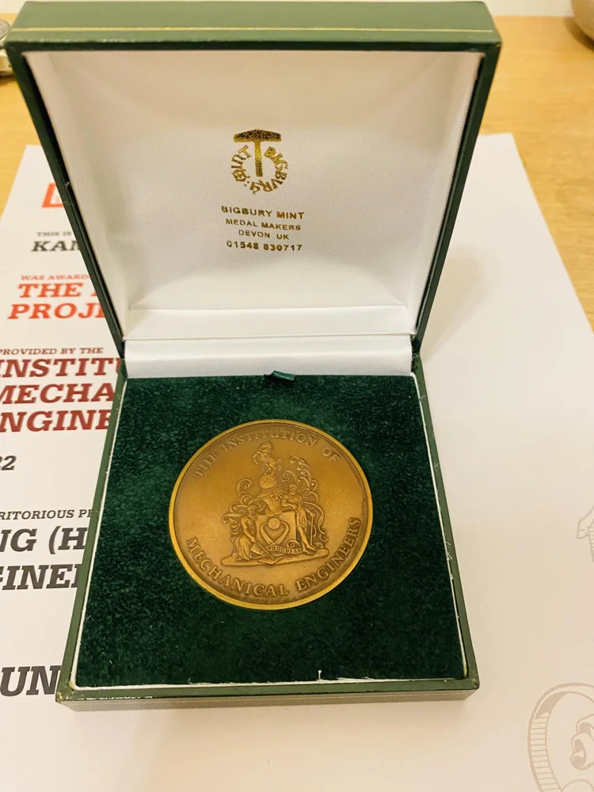</figure>
<figure>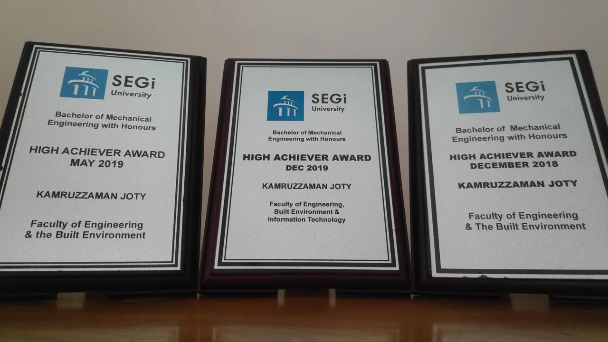</figure>
<figure></figure>
<figure>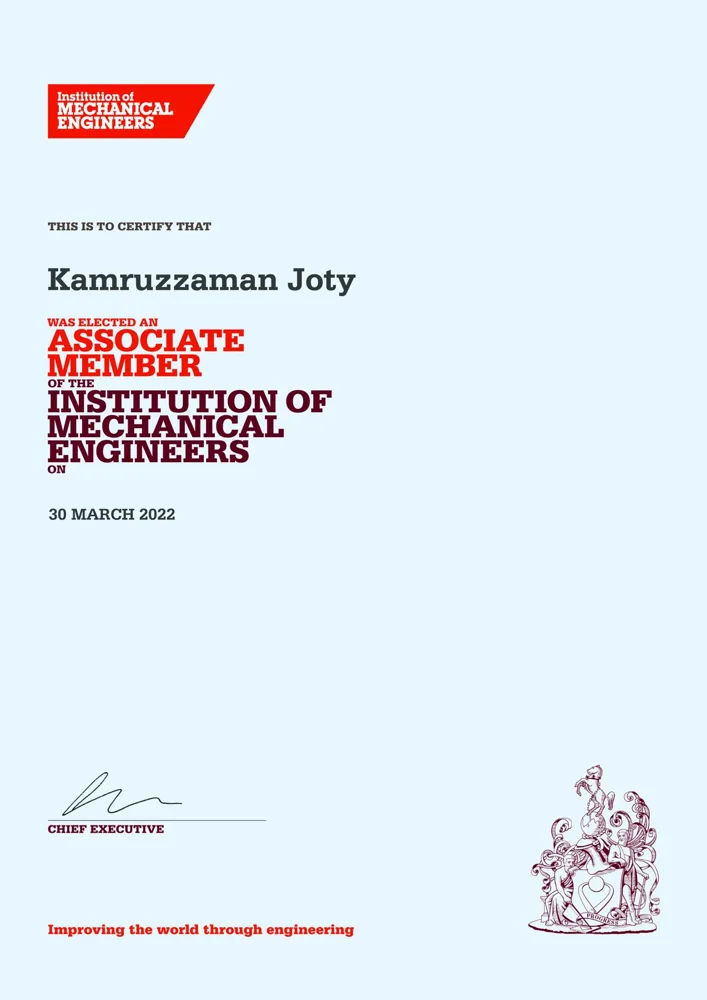</figure>
<figure></figure>
<figure>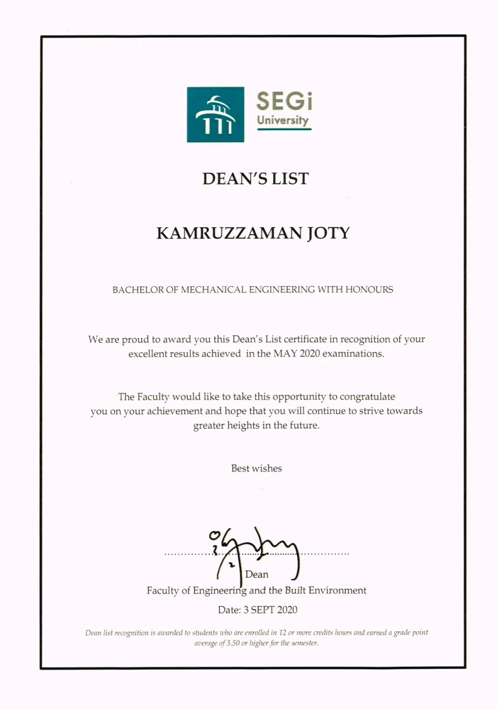</figure>
<figure>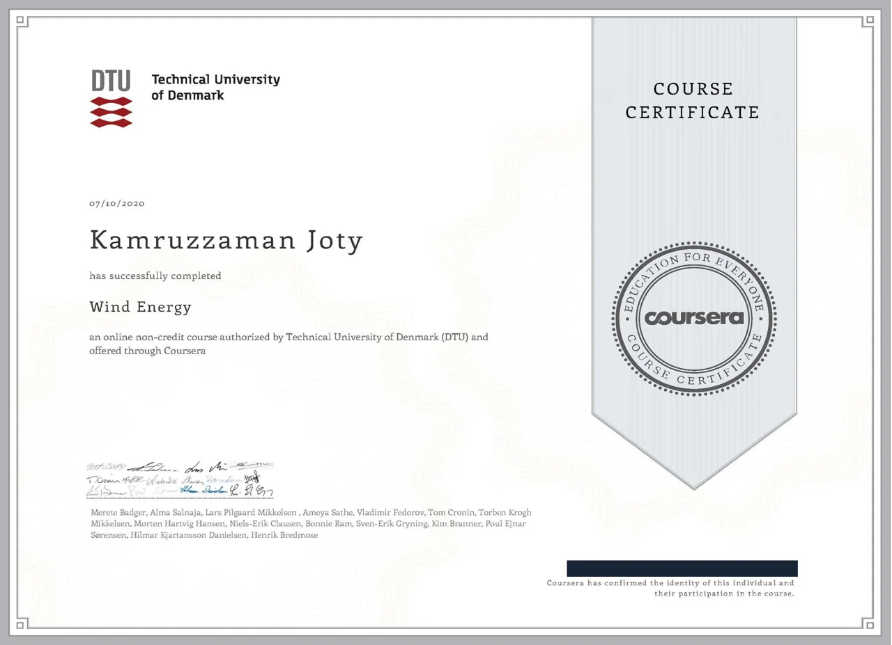</figure>
<figure></figure>
<figure>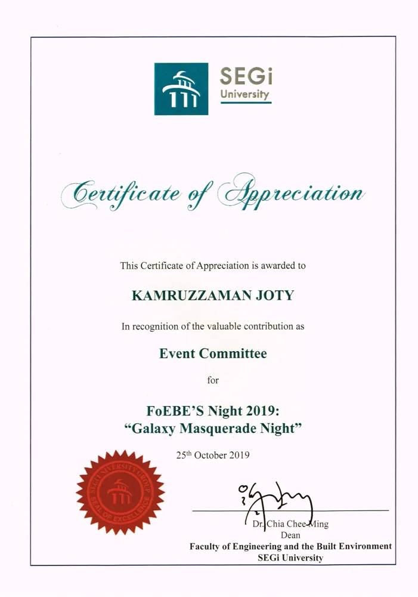</figure>
<figure></figure>
<figure></figure>
<figure>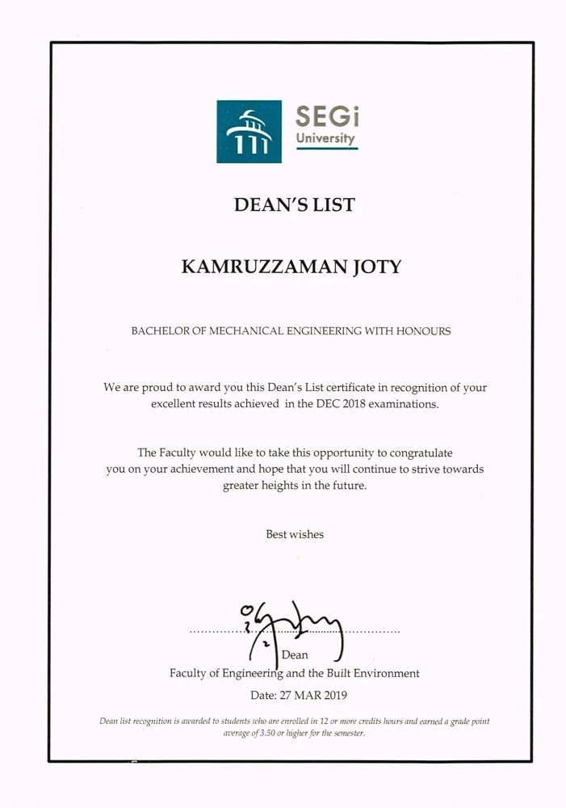</figure>
<figure>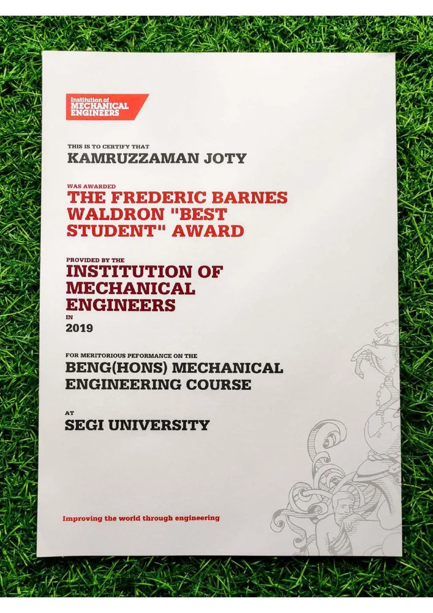</figure>
<figure></figure>
<figure></figure>
<figure></figure>
<figure>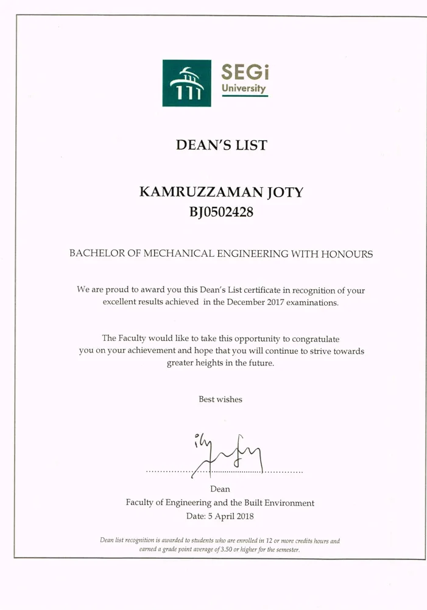</figure>

<button type="button" class="btn btn-outline-primary" data-previous>Previous</button>

<button type="button" class="btn btn-outline-primary" data-next>Next</button>

<!-- award-gallery-end -->
